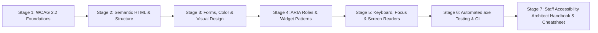
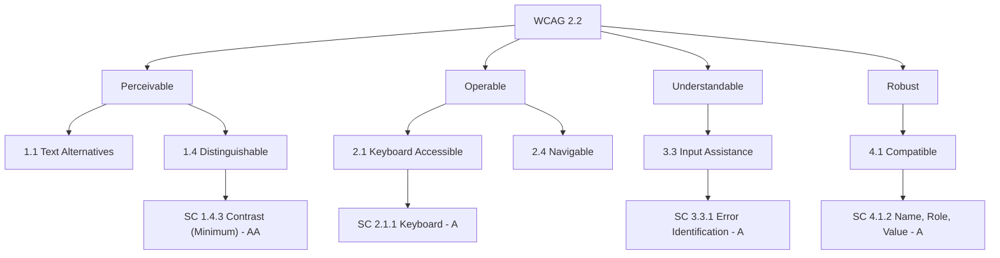
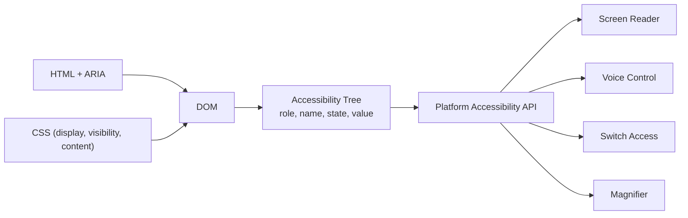
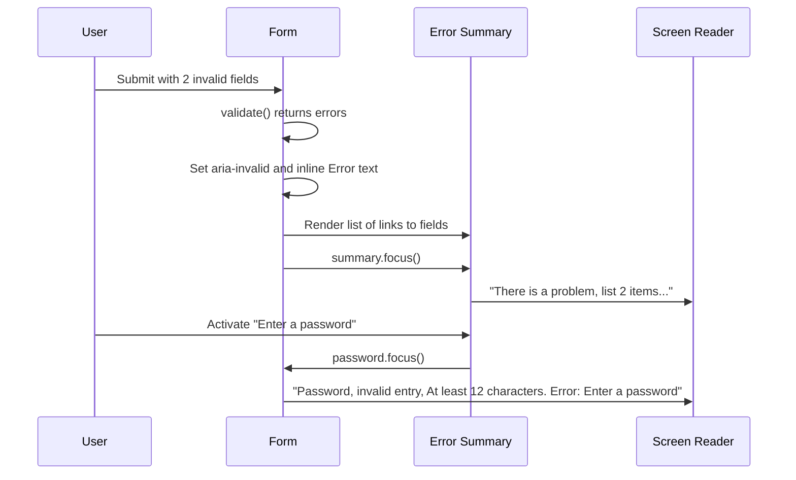
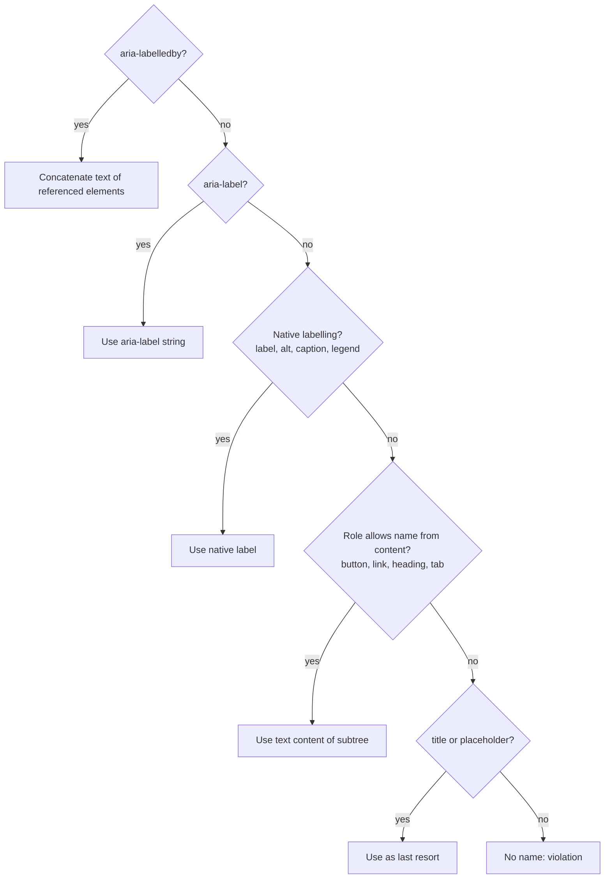
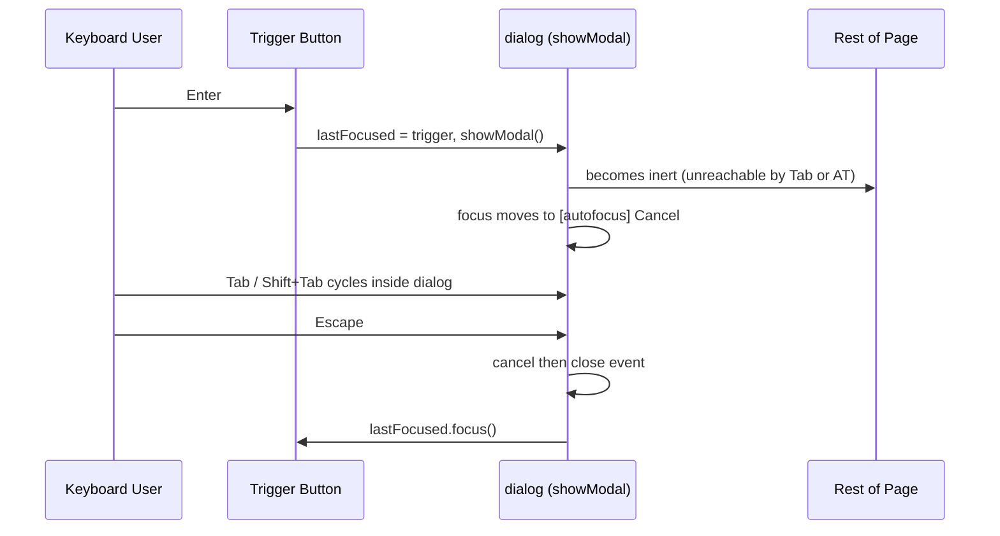
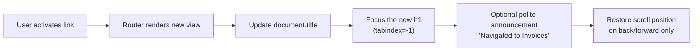
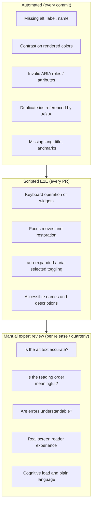
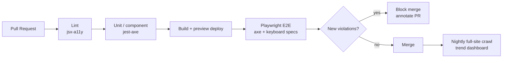

# Learn Web Accessibility ♿

<div align="center">

[](https://opensource.org/licenses/MIT)
[](https://www.w3.org/TR/WCAG22/)
[](https://www.w3.org/TR/wai-aria-1.2/)
[](https://github.com/dequelabs/axe-core)
[](https://playwright.dev/)
[](https://github.com/TheLearningHubOrg/learn-web-accessibility)

**An exhaustive, production-grade masterclass from absolute zero to staff-level web accessibility engineering.**  
Master WCAG 2.2 AA, semantic HTML, ARIA widget patterns, keyboard and focus management, screen reader testing, inclusive visual design, and automated axe-core testing wired into CI.

[Getting Started](#1-stage-1-absolute-beginner-foundations--wcag-22) • [Semantic HTML](#2-stage-2-semantic-html--document-structure) • [Forms & Visual Design](#3-stage-3-forms-color--visual-design) • [ARIA Patterns](#4-stage-4-aria-roles-states--widget-patterns) • [Keyboard & Screen Readers](#5-stage-5-keyboard-focus-management--screen-readers) • [Automated Testing](#6-stage-6-automated-axe-testing--ci-governance) • [Staff Handbook](#7-stage-7-staff-accessibility-architect-interview-handbook--cheatsheet)

<br/>

<a href="https://www.buymeacoffee.com/manthanank">
  
</a>

</div>

---

## 🗺️ 7-Stage Pedagogical Roadmap



| Stage | Domain Focus | Core Concepts & Production Outcomes |
| :--- | :--- | :--- |
| **Stage 1** | **Foundations & WCAG 2.2** | Disability and situational impairment, POUR principles, conformance levels A/AA/AAA, the nine new 2.2 criteria, the accessibility tree, assistive technology landscape, legal drivers. |
| **Stage 2** | **Semantic HTML & Document Structure** | Landmarks (`<main>`, `<nav>`, `<header>`), heading outlines, `lang`, page titles, `alt` text strategy, links vs `<button>`, data tables with `scope` and `<caption>`. |
| **Stage 3** | **Forms, Color & Visual Design** | `<label for>`, `autocomplete`, error summaries, `aria-invalid`, contrast math (4.5:1, 3:1), reflow at 320 CSS px, text spacing, `prefers-reduced-motion`, `forced-colors`, 24x24 targets. |
| **Stage 4** | **ARIA Roles, States & Widget Patterns** | The five rules of ARIA, accessible name computation, live regions (`role="status"`, `role="alert"`), modal `<dialog>`, tabs, disclosure, menu button, combobox. |
| **Stage 5** | **Keyboard, Focus & Screen Readers** | Tab order, `tabindex`, roving tabindex vs `aria-activedescendant`, `inert`, SPA route focus, focus not obscured, NVDA/JAWS/VoiceOver/TalkBack test matrix. |
| **Stage 6** | **Automated axe Testing & CI Governance** | `axe-core` rule tags, `@axe-core/playwright`, keyboard E2E specs, ARIA snapshots, `eslint-plugin-jsx-a11y`, CI gates, manual audit protocol, ACR/VPAT reporting. |
| **Stage 7** | **Staff Accessibility Architect Handbook** | 40 staff-level scenario Q&As, production failure modes, design-system governance, and an enterprise cheatsheet. |

---

## 📋 Table of Contents
- [1. Stage 1: Absolute Beginner Foundations & WCAG 2.2](#1-stage-1-absolute-beginner-foundations--wcag-22)
  - [1.1 Why Accessibility Is an Engineering Requirement](#11-why-accessibility-is-an-engineering-requirement)
  - [1.2 WCAG 2.2 Architecture: POUR, Levels & Success Criteria](#12-wcag-22-architecture-pour-levels--success-criteria)
  - [1.3 What Changed in WCAG 2.2](#13-what-changed-in-wcag-22)
  - [1.4 The Accessibility Tree & Assistive Technology Pipeline](#14-the-accessibility-tree--assistive-technology-pipeline)
- [2. Stage 2: Semantic HTML & Document Structure](#2-stage-2-semantic-html--document-structure)
  - [2.1 The Page Skeleton: lang, title & Landmarks](#21-the-page-skeleton-lang-title--landmarks)
  - [2.2 Heading Outlines & Skip Links](#22-heading-outlines--skip-links)
  - [2.3 Images, Icons & Text Alternatives](#23-images-icons--text-alternatives)
  - [2.4 Links vs Buttons](#24-links-vs-buttons)
  - [2.5 Accessible Data Tables](#25-accessible-data-tables)
- [3. Stage 3: Forms, Color & Visual Design](#3-stage-3-forms-color--visual-design)
  - [3.1 Labels, Hints & Autocomplete](#31-labels-hints--autocomplete)
  - [3.2 Error Identification & Error Summaries](#32-error-identification--error-summaries)
  - [3.3 Color Contrast Mathematics](#33-color-contrast-mathematics)
  - [3.4 Reflow, Zoom & Text Spacing](#34-reflow-zoom--text-spacing)
  - [3.5 Motion, Forced Colors & Target Size](#35-motion-forced-colors--target-size)
- [4. Stage 4: ARIA Roles, States & Widget Patterns](#4-stage-4-aria-roles-states--widget-patterns)
  - [4.1 The Five Rules of ARIA](#41-the-five-rules-of-aria)
  - [4.2 Accessible Name & Description Computation](#42-accessible-name--description-computation)
  - [4.3 Live Regions & Status Messages](#43-live-regions--status-messages)
  - [4.4 Modal Dialog Pattern](#44-modal-dialog-pattern)
  - [4.5 Tabs Pattern](#45-tabs-pattern)
  - [4.6 Disclosure, Menu Button & Combobox](#46-disclosure-menu-button--combobox)
- [5. Stage 5: Keyboard, Focus Management & Screen Readers](#5-stage-5-keyboard-focus-management--screen-readers)
  - [5.1 Tab Order & tabindex Semantics](#51-tab-order--tabindex-semantics)
  - [5.2 Visible Focus & Focus Not Obscured](#52-visible-focus--focus-not-obscured)
  - [5.3 Roving tabindex vs aria-activedescendant](#53-roving-tabindex-vs-aria-activedescendant)
  - [5.4 SPA Route Changes & the inert Attribute](#54-spa-route-changes--the-inert-attribute)
  - [5.5 Screen Reader Testing Matrix](#55-screen-reader-testing-matrix)
- [6. Stage 6: Automated axe Testing & CI Governance](#6-stage-6-automated-axe-testing--ci-governance)
  - [6.1 What Automation Can and Cannot Prove](#61-what-automation-can-and-cannot-prove)
  - [6.2 axe-core with Playwright](#62-axe-core-with-playwright)
  - [6.3 Keyboard Specs & ARIA Snapshots](#63-keyboard-specs--aria-snapshots)
  - [6.4 Component Tests & Linting](#64-component-tests--linting)
  - [6.5 CI Pipeline & Regression Gates](#65-ci-pipeline--regression-gates)
  - [6.6 Manual Audits & Conformance Reports](#66-manual-audits--conformance-reports)
  - [6.7 Running the Companion Examples](#67-running-the-companion-examples)
- [7. Stage 7: Staff Accessibility Architect Interview Handbook & Cheatsheet](#7-stage-7-staff-accessibility-architect-interview-handbook--cheatsheet)
  - [7.1 Enterprise Production Cheatsheet](#71-enterprise-production-cheatsheet)
  - [7.2 Staff & Principal Architect Interview Q&A (40 Scenarios)](#72-staff--principal-architect-interview-qa-40-scenarios)
- [🤝 Contributing](#-contributing)
- [📄 License](#-license)

---

## 1. Stage 1: Absolute Beginner Foundations & WCAG 2.2

### 1.1 Why Accessibility Is an Engineering Requirement

Accessibility is the practice of building interfaces that people can perceive, operate and understand regardless of how they interact with a device. The audience is far wider than most teams assume:

1. **Permanent disabilities:** blindness and low vision, deafness, motor impairments, cognitive and learning disabilities, vestibular disorders.
2. **Temporary impairments:** a broken wrist, post-surgery recovery, dilated pupils after an eye exam.
3. **Situational limits:** bright sunlight on a phone, a noisy train, holding a baby in one arm, a slow connection.
4. **Ageing users:** gradual declines in vision, hearing, dexterity and memory that rarely come with a formal diagnosis.

Treat accessibility like security or performance: a non-functional requirement that is cheap when designed in and expensive when retrofitted. A missing label costs seconds in a pull request and days in a remediation sprint after an audit.

The legal pressure is real and global. In the United States, the ADA and Section 508 drive lawsuits and procurement rules, and the Department of Justice has set WCAG 2.1 AA as the technical standard for state and local government web content, with phased deadlines. In the European Union, the European Accessibility Act has applied to a broad range of consumer products and services since June 2025, with EN 301 549 as the harmonised standard. Canada (ACA, AODA), the UK (Public Sector Bodies Accessibility Regulations) and many others follow the same WCAG baseline.

```
 Cost of fixing an accessibility defect, by phase

 Design system ┃█                                   (token / component fix)
 Pull request  ┃██                                  (lint or axe failure)
 QA / staging  ┃██████                              (manual retest cycle)
 Production    ┃████████████████                    (hotfix, comms, support)
 Post-audit    ┃████████████████████████████████    (remediation program + legal)
```

### 1.2 WCAG 2.2 Architecture: POUR, Levels & Success Criteria

The Web Content Accessibility Guidelines (WCAG) are the W3C standard that nearly every law points at. WCAG 2.2 is the current W3C Recommendation. It is organised in four layers:



1. **Principles (POUR):** Perceivable, Operable, Understandable, Robust.
2. **Guidelines:** 13 goals under the principles, such as 1.4 Distinguishable or 2.4 Navigable.
3. **Success criteria (SC):** the testable statements, each with a level. Conformance is judged only against these.
4. **Techniques and failures:** informative documents describing known ways to meet or fail a criterion.

**Conformance levels:**

| Level | Meaning | Practical target |
| :--- | :--- | :--- |
| **A** | Removes the most severe barriers (keyboard access, text alternatives, no seizure triggers). | Mandatory floor. |
| **AA** | Removes significant barriers (contrast, resize, focus visible, consistent navigation). | The level that laws, contracts and procurement reference. |
| **AAA** | Enhanced support (sign language, 7:1 contrast, no timing). | Apply selectively; not required as a whole for any site. |

A page conforms at AA only when it meets **every** A and AA criterion, for the full page and for complete processes (a checkout is only as accessible as its least accessible step).

### 1.3 What Changed in WCAG 2.2

WCAG 2.2 is backward compatible with 2.1: content that meets 2.2 also meets 2.1 and 2.0. It adds nine success criteria and removes one.

| SC | Name | Level | What it demands |
| :--- | :--- | :--- | :--- |
| 2.4.11 | Focus Not Obscured (Minimum) | AA | A focused element is not entirely hidden by author content such as sticky headers or cookie banners. |
| 2.4.12 | Focus Not Obscured (Enhanced) | AAA | No part of the focused element is hidden. |
| 2.4.13 | Focus Appearance | AAA | Focus indicators meet a minimum area and 3:1 change in contrast. |
| 2.5.7 | Dragging Movements | AA | Every drag operation has a single-pointer alternative (buttons, click-to-place). |
| 2.5.8 | Target Size (Minimum) | AA | Pointer targets are at least 24x24 CSS px, or have enough spacing, with listed exceptions. |
| 3.2.6 | Consistent Help | A | Help mechanisms (contact link, chat) appear in the same relative order across pages. |
| 3.3.7 | Redundant Entry | A | Do not make users re-type information they already gave in the same process. |
| 3.3.8 | Accessible Authentication (Minimum) | AA | No cognitive function test (memorising, transcribing, puzzles) to log in unless an alternative exists; allow paste and password managers. |
| 3.3.9 | Accessible Authentication (Enhanced) | AAA | As above, without the object and personal-content recognition exceptions. |

**Removed:** SC 4.1.1 Parsing is obsolete in 2.2, because modern browsers and assistive technologies all build the tree from the same standardised HTML parsing algorithm.

### 1.4 The Accessibility Tree & Assistive Technology Pipeline

Screen readers never read your HTML directly. The browser derives an **accessibility tree** from the DOM and CSS, and exposes it through a platform API (UI Automation and IAccessible2 on Windows, NSAccessibility on macOS, AT-SPI on Linux, the Android and iOS accessibility frameworks on mobile).



Every node in the tree carries four properties that matter most:

1. **Role:** what it is (`button`, `link`, `heading`, `textbox`, `dialog`).
2. **Name:** what it is called ("Delete project").
3. **State and properties:** `expanded`, `checked`, `selected`, `invalid`, `disabled`, heading level.
4. **Value:** the current value of inputs and ranges.

SC 4.1.2 Name, Role, Value is the formal requirement that every custom control exposes all four correctly. CSS matters here too: `display: none` and `visibility: hidden` remove nodes from the tree, while `opacity: 0` and off-screen positioning do not.

```
 Same pixels, different trees

 <div class="btn" onclick="save()">Save</div>         →  generic  "Save"        (not focusable, no role)
 <button type="button" onclick="save()">Save</button> →  button   "Save"        (focusable, Enter/Space work)
```

---

## 2. Stage 2: Semantic HTML & Document Structure

### 2.1 The Page Skeleton: lang, title & Landmarks

Semantic HTML is the cheapest and most robust accessibility tool available. Native elements ship with roles, keyboard behaviour and states that work across every browser and screen reader combination.

```html
<!doctype html>
<html lang="en">                                <!-- 3.1.1 Language of Page: drives speech synthesis -->
<head>
  <meta charset="utf-8">
  <meta name="viewport" content="width=device-width, initial-scale=1"> <!-- never disable zoom -->
  <title>Invoices - Billing - Acme Cloud</title> <!-- 2.4.2: unique, most specific part first -->
</head>
<body>
  <a class="skip-link" href="#main">Skip to main content</a>

  <header>                                        <!-- banner landmark (when not nested) -->
    <nav aria-label="Primary">                    <!-- label each nav when there is more than one -->
      <ul>
        <li><a href="/dashboard">Dashboard</a></li>
        <li><a href="/billing" aria-current="page">Billing</a></li>
      </ul>
    </nav>
  </header>

  <main id="main">                                <!-- exactly one visible main per page -->
    <h1>Invoices</h1>
    <section aria-labelledby="overdue-heading">   <!-- a section becomes a region only when named -->
      <h2 id="overdue-heading">Overdue</h2>
    </section>
    <p>Prices are shown in <span lang="fr">euros</span>.</p> <!-- 3.1.2 Language of Parts -->
  </main>

  <aside aria-label="Help">...</aside>            <!-- complementary landmark -->
  <footer>...</footer>                            <!-- contentinfo landmark -->
</body>
</html>
```

| Element | Implicit landmark role | Notes |
| :--- | :--- | :--- |
| `<header>` | `banner` | Only when it is not inside `<article>`, `<aside>`, `<main>`, `<nav>` or `<section>`. |
| `<nav>` | `navigation` | Give each one a distinct `aria-label`; do not include the word "navigation". |
| `<main>` | `main` | One per page; the target of skip links. |
| `<aside>` | `complementary` | Related but separable content. |
| `<footer>` | `contentinfo` | Same scoping rule as `<header>`. |
| `<section>` with a name | `region` | Unnamed sections are not landmarks. |
| `<form>` with a name | `form` | Search forms can use `<search>` (current HTML) or `role="search"`. |

### 2.2 Heading Outlines & Skip Links

Screen reader users commonly navigate by headings (the `H` key in NVDA and JAWS, the rotor in VoiceOver). Headings must describe the content below them and nest logically.

```
 Good outline                         Broken outline
 h1 Invoices                          h1 Acme Cloud        ← logo, repeated on every page
   h2 Overdue                           h4 Invoices        ← level chosen for font size
     h3 March 2026                      h2 Overdue
   h2 Paid                              div.bold Paid      ← visual heading, no semantics
```

Rules that hold up in audits:

1. **One `h1` per page** that matches the main purpose (and usually the `<title>`).
2. **Do not skip levels downward** (h2 → h4) because it implies missing sections.
3. **Style with CSS, not heading level.** If a heading must look small, keep the right level and add a class.
4. **Bypass blocks (SC 2.4.1):** a skip link as the first focusable element, landmarks, or both.

```css
/* Skip link: off-screen until focused, then pinned to the top-left corner. */
.skip-link {
  position: absolute;
  left: 0.5rem;
  top: -3rem;
  padding: 0.5rem 1rem;
  background: #0b57d0;
  color: #ffffff;
  z-index: 1000;
}
.skip-link:focus {
  top: 0.5rem;
}
```

### 2.3 Images, Icons & Text Alternatives

SC 1.1.1 requires a text alternative for every non-text element that conveys meaning. The skill is deciding **what** the alternative should say.

| Image purpose | Markup | Reasoning |
| :--- | :--- | :--- |
| **Informative** | `` | Convey the point, not the pixels. |
| **Decorative** | `` | Empty `alt` removes it from the tree. Never omit `alt` entirely. |
| **Functional (inside a link or button)** | `<a href="/"></a>` | Describe the destination or action. |
| **Complex (charts, diagrams)** | Short `alt` plus an adjacent data table or `<details>` | Long descriptions belong in visible or expandable text. |
| **Text in images** | Avoid; use real text (SC 1.4.5) | Real text reflows, zooms and translates. |

```html
<!-- Icon-only button: the SVG is decorative, the button carries the name. -->
<button type="button" aria-label="Close notification">
  <svg aria-hidden="true" focusable="false" width="20" height="20" viewBox="0 0 20 20">
    <path d="M4 4l12 12M16 4L4 16" stroke="currentColor" stroke-width="2"/>
  </svg>
</button>

<!-- Meaningful standalone SVG: give it a role and a name. -->
<svg role="img" aria-labelledby="uptime-title" viewBox="0 0 120 40">
  <title id="uptime-title">Uptime last 30 days: 99.98 percent</title>
  <!-- chart paths -->
</svg>

<!-- Video: captions for deaf users (1.2.2), audio description where visuals carry meaning (1.2.5). -->
<video controls>
  <source src="/media/onboarding.mp4" type="video/mp4">
  <track kind="captions" src="/media/onboarding.en.vtt" srclang="en" label="English" default>
</video>
```

### 2.4 Links vs Buttons

The most common semantic error in production code is a `<div>` or `<a href="#">` acting as a button.

1. **A link navigates:** it changes the URL or moves to another location. Activated by Enter. Announced as "link".
2. **A button performs an action:** submit, open, toggle, delete. Activated by Enter **and** Space. Announced as "button".

```html
<!-- Correct -->
<a href="/reports/2026-q3">View Q3 report</a>
<button type="button" id="export">Export CSV</button>

<!-- Anti-pattern: no role, no focus, no keyboard support -->
<div class="button" onclick="exportCsv()">Export CSV</div>
```

If you are ever forced to make a non-button element behave as a button, this is the full contract you have to rebuild by hand. It shows why the native element is the better choice:

```javascript
// Rebuilding <button> by hand: role, focusability, Enter on keydown, Space on keyup.
const fake = document.querySelector('.button');
fake.setAttribute('role', 'button');
fake.tabIndex = 0;

fake.addEventListener('keydown', (event) => {
  if (event.key === 'Enter') fake.click();
  if (event.key === ' ') event.preventDefault(); // stop the page from scrolling
});
fake.addEventListener('keyup', (event) => {
  if (event.key === ' ') fake.click();
});
// Still missing: disabled state, form submission, forced-colors styling, and more.
```

Link text must make sense out of context (SC 2.4.4). Screen reader users often pull up a list of all links, where ten "Read more" entries are useless. Write "Read more about pricing", or keep the short visible text and extend it with visually hidden text.

### 2.5 Accessible Data Tables

Use `<table>` for tabular data only, never for layout. Header associations let a screen reader announce "Region: EMEA, Q3: 4.2M" as the user moves between cells.

```html
<table>
  <caption>Quarterly revenue by region, in millions of USD</caption>
  <thead>
    <tr>
      <th scope="col">Region</th>
      <th scope="col">Q2</th>
      <th scope="col">Q3</th>
    </tr>
  </thead>
  <tbody>
    <tr>
      <th scope="row">EMEA</th>
      <td>3.9</td>
      <td>4.2</td>
    </tr>
    <tr>
      <th scope="row">APAC</th>
      <td>2.7</td>
      <td>3.1</td>
    </tr>
  </tbody>
</table>
```

For sortable columns, put a `<button>` inside the `<th>` and set `aria-sort="ascending"` or `"descending"` on the `<th>` of the sorted column only.

---

## 3. Stage 3: Forms, Color & Visual Design

### 3.1 Labels, Hints & Autocomplete

Every input needs a programmatic label (SC 1.3.1, 3.3.2, 4.1.2). Placeholders are not labels: they disappear on input, usually fail contrast, and are inconsistently announced.

```html
<div class="field">
  <label for="email">Email address</label>
  <p id="email-hint" class="hint">We only use this to send your receipt.</p>
  <!-- autocomplete supports SC 1.3.5 Identify Input Purpose -->
  <input id="email" name="email" type="email"
         autocomplete="email"
         required
         aria-describedby="email-hint email-error">
  <p id="email-error" class="error-message"></p>
</div>

<fieldset>                                      <!-- group related controls -->
  <legend>Preferred contact method</legend>
  <label><input type="radio" name="contact" value="email"> Email</label>
  <label><input type="radio" name="contact" value="sms"> Text message</label>
</fieldset>
```

1. **`<label for>`** gives a name and a larger click target.
2. **`aria-describedby`** links hints and errors, read after the name and role.
3. **`autocomplete` tokens** (`name`, `email`, `tel`, `street-address`, `one-time-code`, `new-password`) let browsers and password managers fill fields, which helps users with motor and memory impairments and supports SC 3.3.7 and 3.3.8.
4. **Visible labels must match accessible names** (SC 2.5.3 Label in Name) so voice control users can say "click Email address".

### 3.2 Error Identification & Error Summaries

SC 3.3.1 requires errors to be identified in text and SC 3.3.3 requires suggestions where possible. The robust production pattern combines three layers:



```javascript
// Core of the companion example (examples/js/form-errors.js), trimmed for the guide.
for (const name of Object.keys(errors)) {
  const input = form.elements.namedItem(name);
  input.setAttribute('aria-invalid', 'true');

  // Text prefix so the error is not conveyed by red colour alone (SC 1.4.1).
  document.getElementById(`${input.id}-error`).textContent = `Error: ${errors[name]}`;

  const link = document.createElement('a');
  link.href = `#${input.id}`;
  link.textContent = errors[name];
  link.addEventListener('click', (e) => {
    e.preventDefault();
    input.focus(); // jump straight to the field, not just scroll to it
  });
  const item = document.createElement('li');
  item.append(link);
  list.append(item);
}

document.title = `Error: ${document.title.replace(/^Error: /, '')}`;
summary.hidden = false;
summary.focus(); // container has tabindex="-1"
```

Implementation notes:

1. Use `novalidate` on the form and run your own validation, because native browser bubbles vary in wording, timing and screen reader support.
2. Validate on submit, not on every keystroke. Inline validation on blur is acceptable; announcing errors while someone is still typing is not.
3. Keep error message elements in the DOM at all times and only change their text, so the `aria-describedby` references stay valid.
4. Prefix the page title with "Error:" so the problem is announced on reload-style submissions too.

### 3.3 Color Contrast Mathematics

SC 1.4.3 requires a contrast ratio of at least **4.5:1** for normal text and **3:1** for large text (at least 24 CSS px regular, or about 18.66 CSS px bold). SC 1.4.11 requires **3:1** for UI component boundaries, focus indicators and meaningful graphics.

The ratio is computed from the relative luminance of each color. Each sRGB channel $c$ (scaled to 0–1) is linearised first:

$$c_{lin} = \begin{cases} \dfrac{c}{12.92} & c \le 0.04045 \\ \left(\dfrac{c + 0.055}{1.055}\right)^{2.4} & c > 0.04045 \end{cases}$$

$$L = 0.2126\,R_{lin} + 0.7152\,G_{lin} + 0.0722\,B_{lin}$$

$$\text{ratio} = \frac{L_{lighter} + 0.05}{L_{darker} + 0.05}$$

The ratio ranges from 1:1 (identical colors) to 21:1 (black on white). Green dominates luminance, which is why yellow text on white is nearly unreadable even though yellow looks "bright".

```typescript
// contrast.ts: WCAG relative luminance and contrast ratio for hex colors.
function channel(value: number): number {
  const c = value / 255;
  return c <= 0.04045 ? c / 12.92 : ((c + 0.055) / 1.055) ** 2.4;
}

export function luminance(hex: string): number {
  const n = parseInt(hex.replace('#', ''), 16);
  const r = (n >> 16) & 0xff;
  const g = (n >> 8) & 0xff;
  const b = n & 0xff;
  return 0.2126 * channel(r) + 0.7152 * channel(g) + 0.0722 * channel(b);
}

export function contrastRatio(a: string, b: string): number {
  const [hi, lo] = [luminance(a), luminance(b)].sort((x, y) => y - x);
  return (hi + 0.05) / (lo + 0.05);
}

// Design-token gate: fail the build if a text token pair drops below AA.
const pairs: Array<[string, string, number]> = [
  ['#1a1a1a', '#ffffff', 4.5], // body text
  ['#0b57d0', '#ffffff', 4.5], // link / primary button
  ['#6b6b6b', '#ffffff', 3.0], // input border (non-text, SC 1.4.11)
];
for (const [fg, bg, min] of pairs) {
  const ratio = contrastRatio(fg, bg);
  if (ratio < min) throw new Error(`${fg} on ${bg} is ${ratio.toFixed(2)}:1, needs ${min}:1`);
}
```

Never rely on color alone (SC 1.4.1). Required fields, errors, chart series and link text inside paragraphs need a second cue: text, an icon with a text alternative, a pattern or an underline.

### 3.4 Reflow, Zoom & Text Spacing

Low-vision users zoom aggressively. Three criteria cover this:

1. **SC 1.4.4 Resize Text (AA):** text scales to 200% without loss of content or function.
2. **SC 1.4.10 Reflow (AA):** content works at a width equivalent to 320 CSS px (1280 px at 400% zoom) without two-dimensional scrolling, except for content that genuinely needs it (maps, data tables, toolbars).
3. **SC 1.4.12 Text Spacing (AA):** nothing breaks when users override line height to 1.5, paragraph spacing to 2x, letter spacing to 0.12em and word spacing to 0.16em.

```css
/* Production defaults that survive zoom, reflow and user text-spacing overrides. */
html {
  font-size: 100%;               /* respect the user's browser font setting */
}
body {
  font-size: 1rem;               /* rem/em, never fixed px for text */
  line-height: 1.5;
}
.container {
  width: min(72rem, 100% - 2rem); /* fluid, no fixed widths */
  margin-inline: auto;
}
.card-grid {
  display: grid;
  grid-template-columns: repeat(auto-fit, minmax(min(18rem, 100%), 1fr));
  gap: 1rem;
}
.badge {
  min-height: 1.5em;             /* min-height, not height, so text can grow */
  padding: 0.25em 0.5em;
}
.data-table-wrapper {
  overflow-x: auto;              /* allowed: tables are a 1.4.10 exception */
}
```

SC 1.4.13 Content on Hover or Focus adds that tooltips and popovers must be **dismissible** (Escape closes them without moving focus), **hoverable** (the pointer can move onto them) and **persistent** (they stay until dismissed or no longer relevant).

### 3.5 Motion, Forced Colors & Target Size

Respect operating system preferences through media queries:

```css
/* 1. Motion: vestibular disorders can be triggered by parallax and large transitions. */
@media (prefers-reduced-motion: reduce) {
  *, *::before, *::after {
    animation-duration: 0.01ms !important;
    animation-iteration-count: 1 !important;
    transition-duration: 0.01ms !important;
    scroll-behavior: auto !important;
  }
}

/* 2. Forced colors (Windows contrast themes): the OS replaces your palette.
      Box-shadow focus rings vanish, so keep a transparent outline as a fallback. */
.button:focus-visible {
  box-shadow: 0 0 0 3px #0b57d0;
  outline: 2px solid transparent;  /* becomes visible in forced-colors mode */
}
@media (forced-colors: active) {
  .icon {
    forced-color-adjust: auto;
    fill: CanvasText;              /* system color keywords */
  }
  .selected-tab {
    border: 2px solid Highlight;   /* do not rely on background color for state */
  }
}

/* 3. Target size: SC 2.5.8 needs 24x24 CSS px minimum; 44x44 is a comfortable default. */
.icon-button {
  min-width: 44px;
  min-height: 44px;
  display: inline-grid;
  place-items: center;
}
```

SC 2.3.1 forbids content that flashes more than three times per second above the general and red flash thresholds. SC 2.2.2 requires a pause, stop or hide control for anything that moves, blinks or auto-updates for more than five seconds, such as carousels and tickers.

---

## 4. Stage 4: ARIA Roles, States & Widget Patterns

### 4.1 The Five Rules of ARIA

WAI-ARIA (Accessible Rich Internet Applications) lets you add or change roles, states and properties in the accessibility tree. It changes **semantics only**: it never adds focus, keyboard handling or visual behaviour.

1. **Prefer native HTML.** If an element with the semantics and behaviour you need exists, use it.
2. **Do not change native semantics** unless you really must (`<h2 role="tab">` breaks the heading; wrap instead).
3. **Every interactive ARIA control must be keyboard operable.**
4. **Never put `role="presentation"` or `aria-hidden="true"` on a focusable element**, or users will tab to something that does not exist for them.
5. **Every interactive element needs an accessible name.**

```
 The ARIA paradox
 ┌──────────────────────────────┬──────────────────────────────┐
 │ No ARIA                      │ Bad ARIA                     │
 │ Missing semantics: users     │ Wrong semantics: users are   │
 │ must guess.                  │ actively misled.             │
 └──────────────────────────────┴──────────────────────────────┘
   Large-scale audits consistently find more errors on pages
   that use ARIA than on pages that do not.
```

| Category | Examples | Purpose |
| :--- | :--- | :--- |
| **Widget roles** | `button`, `tab`, `tabpanel`, `switch`, `slider`, `combobox`, `option`, `menuitem` | Interactive controls. |
| **Structure roles** | `heading`, `list`, `table`, `img`, `group`, `toolbar` | Document structure. |
| **Landmark roles** | `banner`, `navigation`, `main`, `region`, `search` | Page regions. |
| **Live region roles** | `status`, `alert`, `log`, `timer` | Announce changes. |
| **States** | `aria-expanded`, `aria-selected`, `aria-checked`, `aria-pressed`, `aria-invalid`, `aria-disabled`, `aria-current` | Change at runtime. |
| **Properties** | `aria-label`, `aria-labelledby`, `aria-describedby`, `aria-controls`, `aria-haspopup`, `aria-live` | Relationships and names. |

### 4.2 Accessible Name & Description Computation

Browsers follow the Accessible Name and Description Computation specification. In simplified priority order:



Practical consequences:

1. **`aria-labelledby` wins over everything**, can reference hidden elements, and can combine several ids: `aria-labelledby="section-title row-3-name"`.
2. **`aria-label` replaces visible text** for the accessible name, so it can break SC 2.5.3 Label in Name if it does not contain the visible words.
3. **`aria-label` is ignored on generic elements** (`<div>`, `<span>` without a role) and is poorly translated by automatic page translation; prefer visible text.
4. **Descriptions** come from `aria-describedby` (or `title` when not used for the name) and are read after the name and role, often after a short pause.

### 4.3 Live Regions & Status Messages

SC 4.1.3 Status Messages requires that status updates (search result counts, "Saved", cart totals) are announced **without moving focus**. Live regions do this.

```html
<!-- Polite: announced when the screen reader is idle. Use for most updates. -->
<div id="search-status" role="status"></div>

<!-- Assertive: interrupts current speech. Reserve for time-critical errors. -->
<div id="session-alert" role="alert"></div>
```

```javascript
// announce.js: a reusable announcer that works around common live region pitfalls.
const regions = {};

function getRegion(politeness) {
  if (!regions[politeness]) {
    const el = document.createElement('div');
    el.setAttribute('role', politeness === 'assertive' ? 'alert' : 'status');
    el.className = 'visually-hidden';
    document.body.append(el); // 1. Region must exist BEFORE content is injected.
    regions[politeness] = el;
  }
  return regions[politeness];
}

export function announce(message, politeness = 'polite') {
  const region = getRegion(politeness);
  region.textContent = '';                 // 2. Clear so identical messages re-announce.
  setTimeout(() => {                       // 3. Separate the update into its own task.
    region.textContent = message;
  }, 100);
}

// Usage
announce('42 results found for "invoice"');
announce('Your session expires in 2 minutes', 'assertive');
```

Live region pitfalls:

1. Injecting an element that already contains text, with `role="alert"` on it, is announced inconsistently. Create the empty region on page load and change its text later.
2. Announcing every keystroke of a type-ahead search floods the speech queue. Debounce announcements to around 500 ms or more.
3. `aria-live` on large containers (a whole chat log) reads too much. Use `role="log"` with additions only, or announce a summary.

### 4.4 Modal Dialog Pattern

A modal dialog must (1) move focus into itself on open, (2) keep Tab and Shift+Tab inside, (3) make the background inert, (4) close on Escape, and (5) return focus to the element that opened it. The native `<dialog>` element with `showModal()` handles 1–4 in all current evergreen browsers.



```html
<button type="button" id="open-delete" aria-haspopup="dialog">Delete project</button>
<p id="dialog-result" role="status"></p>

<dialog id="delete-dialog" aria-labelledby="delete-title" aria-describedby="delete-desc">
  <h2 id="delete-title">Delete this project?</h2>
  <p id="delete-desc">The project and its 12 files will be removed. You cannot undo this.</p>
  <div class="dialog-actions">
    <!-- For destructive dialogs, start focus on the safe choice. -->
    <button type="button" class="secondary" data-close="cancel" autofocus>Cancel</button>
    <button type="button" data-close="confirm">Delete project</button>
  </div>
</dialog>
```

```javascript
// examples/js/dialog.js
export function setupDialog(trigger, dialog, onClose) {
  let lastFocused = null;

  trigger.addEventListener('click', () => {
    lastFocused = document.activeElement;
    dialog.returnValue = '';
    dialog.showModal();
  });

  dialog.addEventListener('click', (event) => {
    const button = event.target.closest('[data-close]');
    if (button) dialog.close(button.dataset.close);
  });

  // Fires for close() calls and for Escape.
  dialog.addEventListener('close', () => {
    onClose(dialog.returnValue || 'cancel');
    if (lastFocused instanceof HTMLElement && lastFocused.isConnected) lastFocused.focus();
  });
}
```

Avoid `dialog.show()` for modals: it opens the dialog non-modally, so the background stays interactive and there is no focus containment. For non-modal floating content (menus, tooltips, pickers), the `popover` attribute gives light dismiss and top-layer rendering without making the page inert.

### 4.5 Tabs Pattern

The tabs pattern groups panels behind a single Tab stop. Arrow keys move between tabs; Tab moves into the active panel.

```
 Keyboard model (automatic activation)

  Tab ──► [ Overview ]  Pricing   Support    ◄── only the selected tab has tabindex="0"
              │   → / ←  move + select (wraps)
              │   Home / End  first / last
              ▼
  Tab ──► ┌──────────────────────────────┐
          │ Active tabpanel (tabindex=0) │
          └──────────────────────────────┘
```

```html
<div role="tablist" aria-label="Plan details">
  <button type="button" role="tab" id="tab-overview" aria-controls="panel-overview" aria-selected="true">Overview</button>
  <button type="button" role="tab" id="tab-pricing" aria-controls="panel-pricing" aria-selected="false" tabindex="-1">Pricing</button>
  <button type="button" role="tab" id="tab-support" aria-controls="panel-support" aria-selected="false" tabindex="-1">Support</button>
</div>

<div role="tabpanel" id="panel-overview" aria-labelledby="tab-overview" tabindex="0">...</div>
<div role="tabpanel" id="panel-pricing" aria-labelledby="tab-pricing" tabindex="0" hidden>...</div>
<div role="tabpanel" id="panel-support" aria-labelledby="tab-support" tabindex="0" hidden>...</div>
```

```javascript
// examples/js/tabs.js (keyboard handler)
tablist.addEventListener('keydown', (event) => {
  const current = tabs.indexOf(document.activeElement);
  if (current === -1) return;

  let next = null;
  switch (event.key) {
    case 'ArrowRight': next = (current + 1) % tabs.length; break;
    case 'ArrowLeft': next = (current - 1 + tabs.length) % tabs.length; break;
    case 'Home': next = 0; break;
    case 'End': next = tabs.length - 1; break;
    default: return; // leave Tab, Enter and Space to the browser
  }
  event.preventDefault();
  select(tabs[next]); // updates aria-selected, tabindex, hidden and moves focus
});
```

Choose **automatic activation** (selection follows focus) when panels render instantly. Choose **manual activation** (arrows move focus, Enter or Space selects) when showing a panel triggers a network request or heavy render.

### 4.6 Disclosure, Menu Button & Combobox

**Disclosure (show/hide):** the simplest widget, and the one teams most often over-engineer.

```html
<!-- Native: zero JavaScript, correct semantics everywhere. -->
<details>
  <summary>Shipping and returns</summary>
  <p>Free returns within 30 days.</p>
</details>

<!-- Custom disclosure when design needs it: a button with aria-expanded. -->
<button type="button" aria-expanded="false" aria-controls="filters">Filters</button>
<div id="filters" hidden>...</div>
```

```javascript
const toggle = document.querySelector('[aria-controls="filters"]');
const panel = document.getElementById('filters');
toggle.addEventListener('click', () => {
  const open = toggle.getAttribute('aria-expanded') === 'true';
  toggle.setAttribute('aria-expanded', String(!open));
  panel.hidden = open;
});
```

**Menu button:** `role="menu"` is for application-style action menus (like a desktop app's File menu), with arrow-key navigation and `menuitem` children. Site navigation is **not** a menu. A list of links inside `<nav>`, with disclosure buttons for sub-lists, is the right pattern for navigation, because `role="menu"` switches screen readers into a mode where normal link behaviour is not expected.

**Combobox (autocomplete):** the hardest common widget. Its essential contract:

| Element | Attributes |
| :--- | :--- |
| Input | `role="combobox"`, `aria-expanded`, `aria-controls="listbox-id"`, `aria-autocomplete="list"`, `aria-activedescendant="option-id"` while navigating |
| Popup | `role="listbox"` with `role="option"` children, each with a unique `id` and `aria-selected` on the active one |
| Keys | Down/Up move the active option, Enter selects, Escape closes (and a second Escape may clear), typing filters |
| Status | A polite live region announcing "5 suggestions available" after filtering settles |

Before building one, check whether a native `<select>`, an `<input list>` with `<datalist>`, or a well-tested library component meets the requirement.

---

## 5. Stage 5: Keyboard, Focus Management & Screen Readers

### 5.1 Tab Order & tabindex Semantics

SC 2.1.1 requires that all functionality is operable by keyboard, and SC 2.1.2 forbids keyboard traps. SC 2.4.3 requires a focus order that preserves meaning, which in practice means DOM order must match visual order.

| Value | Effect | Use it for |
| :--- | :--- | :--- |
| *(none)* on native controls | Focusable in DOM order | Links, buttons, inputs: the default you want. |
| `tabindex="0"` | Adds a non-native element to the natural Tab order | Custom widgets, scrollable regions, tab panels. |
| `tabindex="-1"` | Focusable by script only, removed from Tab order | Headings or containers you move focus to, inactive roving items. |
| `tabindex="1"` or higher | Jumps ahead of everything else | **Never.** It creates an order that no one can maintain. |

```
 Visual order vs DOM order (CSS reordering trap)

 Visual:  [ Cancel ]  [ Save ]            ← flex-direction: row-reverse
 DOM:     <button>Save</button><button>Cancel</button>
 Tab:     Save → Cancel                    ← focus jumps right-to-left: fails 2.4.3
```

Grid `order`, `flex-direction: *-reverse` and absolute positioning all change visual order without touching DOM order. Fix the source order instead.

### 5.2 Visible Focus & Focus Not Obscured

SC 2.4.7 Focus Visible (AA) requires a visible indicator. SC 2.4.11 Focus Not Obscured (AA, new in 2.2) requires that sticky headers, footers and banners do not entirely cover the focused element.

```css
/* 1. Global, high-contrast focus ring for keyboard users only. */
:focus-visible {
  outline: 3px solid #0b57d0;
  outline-offset: 2px;
}

/* 2. Never remove outlines without a replacement. This line fails SC 2.4.7: */
/* *:focus { outline: none; } */

/* 3. Keep focused elements clear of a 4rem sticky header and a cookie banner (SC 2.4.11). */
html {
  scroll-padding-top: 5rem;
  scroll-padding-bottom: 6rem;
}

/* 4. Dark surfaces need their own ring color to keep 3:1 against the background. */
.footer :focus-visible {
  outline-color: #ffffff;
}
```

### 5.3 Roving tabindex vs aria-activedescendant

Composite widgets (tabs, toolbars, listboxes, grids, tree views) should be a **single Tab stop**, with arrow keys moving inside. Two techniques implement this:

| Aspect | Roving tabindex | `aria-activedescendant` |
| :--- | :--- | :--- |
| **DOM focus** | Moves to each item (`tabindex` 0 on active, -1 on others) | Stays on the container or input |
| **Scrolling into view** | Automatic (browser scrolls focused element) | Manual (`scrollIntoView` on the active item) |
| **Styling** | `:focus-visible` works | Needs a class or `[aria-selected]` styling |
| **Best for** | Tabs, toolbars, radio-like groups, menus | Combobox (focus must stay in the text input), large virtualised lists |
| **Screen reader support** | Very consistent | Good, but more variation across combinations |

```javascript
// Roving tabindex for a toolbar, reusable for any one-dimensional composite.
export function rovingTabindex(container, itemSelector, orientation = 'horizontal') {
  const items = () => Array.from(container.querySelectorAll(itemSelector))
    .filter((el) => !el.disabled && !el.hidden);
  const [prevKey, nextKey] = orientation === 'vertical'
    ? ['ArrowUp', 'ArrowDown']
    : ['ArrowLeft', 'ArrowRight'];

  items().forEach((el, i) => { el.tabIndex = i === 0 ? 0 : -1; });

  container.addEventListener('keydown', (event) => {
    const list = items();
    const index = list.indexOf(document.activeElement);
    if (index === -1) return;

    const map = { [prevKey]: index - 1, [nextKey]: index + 1, Home: 0, End: list.length - 1 };
    if (!(event.key in map)) return;
    event.preventDefault();

    const target = list[(map[event.key] + list.length) % list.length];
    list[index].tabIndex = -1;
    target.tabIndex = 0;
    target.focus();
  });
}
```

### 5.4 SPA Route Changes & the inert Attribute

A traditional page load resets focus to the top of the document and makes screen readers announce the new title. Client-side routing does neither, so users are left on a link that may no longer exist, with no idea the view changed.



```typescript
// route-focus.ts: framework-agnostic focus management after client-side navigation.
export function onRouteRendered(pageTitle: string): void {
  document.title = `${pageTitle} - Acme Cloud`;

  const heading = document.querySelector<HTMLElement>('main h1');
  if (!heading) return;

  heading.tabIndex = -1;                  // focusable by script, not in the Tab order
  heading.focus({ preventScroll: false });
  heading.addEventListener('blur', () => heading.removeAttribute('tabindex'), { once: true });
}

// Example wiring with the Navigation API, falling back to your router's hook.
if ('navigation' in window) {
  (window as any).navigation.addEventListener('navigatesuccess', () => {
    const h1 = document.querySelector('main h1');
    onRouteRendered(h1?.textContent?.trim() ?? 'Page');
  });
}
```

The **`inert`** attribute removes an entire subtree from focus, pointer events and the accessibility tree in one step. Use it for custom drawers and off-canvas menus when the native modal `<dialog>` does not fit:

```javascript
// Open a custom side drawer: everything except the drawer becomes inert.
function openDrawer(drawer, appRoot) {
  appRoot.inert = true;        // <div id="app"> holds the page; the drawer lives outside it
  drawer.hidden = false;
  drawer.querySelector('h2').focus();
}

function closeDrawer(drawer, appRoot, trigger) {
  drawer.hidden = true;
  appRoot.inert = false;
  trigger.focus();             // always restore focus to the opener
}
```

### 5.5 Screen Reader Testing Matrix

Screen readers pair with specific browsers. Test the combinations your users actually run:

| Screen reader | Platform | Pair with | Cost |
| :--- | :--- | :--- | :--- |
| **NVDA** | Windows | Chrome, Firefox, Edge | Free, open source |
| **JAWS** | Windows | Chrome, Edge | Commercial licence |
| **Narrator** | Windows | Edge | Built in |
| **VoiceOver** | macOS | Safari | Built in |
| **VoiceOver** | iOS / iPadOS | Safari | Built in |
| **TalkBack** | Android | Chrome | Built in |
| **Orca** | Linux (GNOME) | Firefox | Free, open source |

A pragmatic enterprise baseline: **NVDA + Chrome**, **JAWS + Chrome**, **VoiceOver + Safari on iOS**, and **VoiceOver + Safari on macOS** for teams with Mac-heavy users. Add TalkBack for Android-first products.

**Essential commands for a first smoke test:**

| Task | NVDA / JAWS (Windows) | VoiceOver (macOS) |
| :--- | :--- | :--- |
| Start / stop | NVDA: `Ctrl+Alt+N` to start, `Insert+Q` to quit | `Cmd+F5` |
| Read next item | `Down Arrow` (browse mode) | `VO+Right Arrow` (VO = `Ctrl+Option`) |
| Next heading | `H` | `VO+Cmd+H` |
| Next landmark | `D` (NVDA) / `R` (JAWS) | Rotor: `VO+U`, then choose landmarks |
| List links / headings | `Insert+F7` | `VO+U` |
| Next form field | `F` | `VO+Cmd+J` |
| Toggle browse / focus mode | NVDA: `Insert+Space`; JAWS: `Enter` enters forms mode, `Numpad Plus` leaves it | Not applicable (VoiceOver uses a different interaction model) |

Understand **browse mode vs focus mode** on Windows: in browse mode, single letters are navigation shortcuts; in focus mode (entered automatically in text inputs and inside widgets like `role="application"` or composite widgets), keys go to the page. Custom widgets that do not trigger focus mode correctly will have their arrow-key handlers swallowed by the screen reader.

**Smoke test script for every new feature:**

1. Tab through the whole flow without a mouse. Can you reach and operate everything, and can you always see where focus is?
2. With a screen reader, navigate by headings and landmarks. Does the structure explain the page?
3. Operate each control. Does it announce a sensible name, role and state, and do state changes (expanded, selected, invalid) get announced?
4. Trigger every async update. Is it announced without stealing focus?
5. Zoom to 400% at 1280 px wide. Does anything overlap, clip or require horizontal scrolling?

---

## 6. Stage 6: Automated axe Testing & CI Governance

### 6.1 What Automation Can and Cannot Prove

Automated engines are excellent at deterministic checks and blind to meaning. Plan your testing strategy around that split.



`axe-core` is the de facto open-source engine (it also powers Lighthouse's accessibility audit and many browser extensions). Its design goal is **no false positives**: when a rule cannot decide, the node goes to `incomplete` ("needs review") rather than `violations`. The result object has four buckets:

| Bucket | Meaning | CI action |
| :--- | :--- | :--- |
| `violations` | Definite failures | Fail the build. |
| `incomplete` | Could not be decided (contrast over a background image, for example) | Log and triage manually. |
| `passes` | Rules that ran and passed | Useful for coverage reporting. |
| `inapplicable` | Rules with no matching elements | Ignore. |

### 6.2 axe-core with Playwright

`@axe-core/playwright` injects axe into the page and runs it against the live, rendered DOM, which catches contrast and state problems that static linting cannot see.

```javascript
// tests/a11y.spec.js (from this repository)
import { test, expect } from '@playwright/test';
import AxeBuilder from '@axe-core/playwright';

const WCAG_TAGS = ['wcag2a', 'wcag2aa', 'wcag21a', 'wcag21aa', 'wcag22aa'];
const PAGES = ['/index.html', '/dialog.html', '/tabs.html', '/form-errors.html'];

async function expectNoViolations(page, include) {
  let builder = new AxeBuilder({ page }).withTags(WCAG_TAGS);
  if (include) builder = builder.include(include);
  const { violations } = await builder.analyze();
  // Map to "rule-id: selector" so a failure message is readable in CI logs.
  const summary = violations.map((v) => `${v.id}: ${v.nodes.map((n) => n.target.join(' ')).join(', ')}`);
  expect(summary, 'axe-core WCAG violations').toEqual([]);
}

test.describe('axe-core WCAG 2.2 AA scan', () => {
  for (const path of PAGES) {
    test(`${path} has no detectable violations`, async ({ page }) => {
      await page.goto(path);
      await expectNoViolations(page);
    });
  }

  // Scan dynamic states too: most real bugs live in opened dialogs and error states.
  test('form in its error state has no violations', async ({ page }) => {
    await page.goto('/form-errors.html');
    await page.getByRole('button', { name: 'Create account' }).click();
    await expect(page.locator('#error-summary')).toBeVisible();
    await expectNoViolations(page);
  });
});
```

Useful `AxeBuilder` controls:

1. **`.withTags([...])`** restricts rules to WCAG levels. Add `'best-practice'` for stricter, non-normative rules.
2. **`.include(selector)` / `.exclude(selector)`** scope the scan, for example to exclude a third-party chat widget you do not control (and track it separately).
3. **`.disableRules(['color-contrast'])`** for a documented, time-boxed exception. Prefer fixing over disabling.
4. **Scan after interactions.** A page-load scan only sees the initial state; open menus, dialogs, validation errors and expanded accordions before scanning.

### 6.3 Keyboard Specs & ARIA Snapshots

axe cannot press keys. Playwright can, and its role-based locators double as accessibility assertions: if `getByRole('button', { name: 'Cancel' })` finds nothing, the button either has the wrong role or no accessible name.

```javascript
test('dialog moves focus in, keeps it inside, and restores it on Escape', async ({ page }) => {
  await page.goto('/dialog.html');
  const trigger = page.locator('#open-delete');
  await trigger.focus();
  await page.keyboard.press('Enter');

  const dialog = page.getByRole('dialog', { name: 'Delete this project?' });
  await expect(dialog).toBeVisible();
  await expect(dialog.getByRole('button', { name: 'Cancel' })).toBeFocused();

  for (let i = 0; i < 4; i += 1) {
    await page.keyboard.press('Tab');
    await expect(trigger).not.toBeFocused(); // background is inert
  }

  await page.keyboard.press('Escape');
  await expect(dialog).toBeHidden();
  await expect(trigger).toBeFocused();       // focus restored
});

test('email field exposes its hint and error as a description', async ({ page }) => {
  await page.goto('/form-errors.html');
  await page.getByLabel('Email address').fill('not-an-email');
  await page.getByRole('button', { name: 'Create account' }).click();

  const email = page.getByLabel('Email address');
  await expect(email).toHaveAttribute('aria-invalid', 'true');
  await expect(email).toHaveAccessibleDescription(
    'We only use this to send your receipt. Error: Enter an email address in the format name@example.com',
  );
});
```

ARIA snapshots record the accessibility tree of a region as YAML and fail when it changes, which catches regressions such as a heading that lost its level or a button that lost its name:

```javascript
test('tab list structure is stable', async ({ page }) => {
  await page.goto('/tabs.html');
  await expect(page.getByRole('tablist')).toMatchAriaSnapshot(`
    - tablist "Plan details":
      - tab "Overview" [selected]
      - tab "Pricing"
      - tab "Support"
  `);
});
```

### 6.4 Component Tests & Linting

Shift the cheapest checks as far left as possible.

```javascript
// eslint.config.js: flat config with JSX accessibility rules for a React codebase.
import jsxA11y from 'eslint-plugin-jsx-a11y';

export default [
  {
    files: ['src/**/*.{jsx,tsx}'],
    ...jsxA11y.flatConfigs.strict,
    rules: {
      ...jsxA11y.flatConfigs.strict.rules,
      // Not part of the strict preset: every interactive control needs a text label.
      'jsx-a11y/control-has-associated-label': 'error',
    },
    settings: {
      // Teach the linter about design-system components that render native elements.
      'jsx-a11y': {
        components: { Button: 'button', TextField: 'input', Link: 'a' },
      },
    },
  },
];
```

```typescript
// Button.test.tsx: component-level axe check with Vitest, Testing Library and jest-axe.
import { render, screen } from '@testing-library/react';
import userEvent from '@testing-library/user-event';
import { axe, toHaveNoViolations } from 'jest-axe';
import { expect, test, vi } from 'vitest';
import { IconButton } from './IconButton';

expect.extend(toHaveNoViolations);

test('icon button has an accessible name and no axe violations', async () => {
  const user = userEvent.setup();
  const onPress = vi.fn();
  const { container } = render(<IconButton icon="trash" label="Delete invoice" onPress={onPress} />);

  // 1. Role + name query fails if the label is missing.
  const button = screen.getByRole('button', { name: 'Delete invoice' });

  // 2. Keyboard activation works with Space and Enter.
  button.focus();
  await user.keyboard('[Space]');
  await user.keyboard('[Enter]');
  expect(onPress).toHaveBeenCalledTimes(2);

  // 3. axe on the rendered fragment (color-contrast needs a real browser, so jsdom skips it).
  expect(await axe(container)).toHaveNoViolations();
});
```

The test pyramid for accessibility:

```
               ▲  Manual screen reader + expert audit   (few, high value)
              ▲▲▲  Playwright keyboard specs + axe on key flows
            ▲▲▲▲▲▲▲  Component tests with jest-axe and role queries
       ▲▲▲▲▲▲▲▲▲▲▲▲▲▲▲  Lint rules + design-token contrast checks (every save)
```

### 6.5 CI Pipeline & Regression Gates



```yaml
# .github/workflows/accessibility.yml
name: accessibility
on:
  pull_request:
  push:
    branches: [main]

jobs:
  a11y:
    runs-on: ubuntu-latest
    timeout-minutes: 15
    steps:
      - uses: actions/checkout@v7

      - uses: actions/setup-node@v7
        with:
          node-version: 24
          cache: npm

      # 1. Install dependencies and only the browser we test against.
      - run: npm ci
      - run: npx playwright install --with-deps chromium

      # 2. Run axe + keyboard suite; the config starts the static server itself.
      - run: npx playwright test
        env:
          CI: 'true'

      # 3. Keep traces for failed tests so reviewers can replay focus problems.
      - if: failure()
        uses: actions/upload-artifact@v7
        with:
          name: playwright-traces
          path: test-results/
          retention-days: 7
```

**Adopting gates on a legacy product.** Turning on a zero-violation gate against a codebase with thousands of existing failures blocks every team on day one. Use a ratchet instead:

1. Record a baseline of existing violations keyed by rule id and a stable selector or component name.
2. Fail CI only on violations **not** in the baseline.
3. Shrink the baseline as teams fix issues, and fail CI if the baseline file grows.
4. Hold new components and new pages to zero violations from the start.

### 6.6 Manual Audits & Conformance Reports

Automated tools can fully decide only a small part of the WCAG criteria. A conformance claim needs a structured manual review:

1. **Define scope:** representative pages and every complete process (sign-up, checkout, account recovery).
2. **Evaluate per criterion:** walk all A and AA success criteria with keyboard, screen reader, zoom and contrast tools, recording pass, fail or not applicable with evidence.
3. **Rate severity:** blocker (cannot complete a task), serious, moderate, minor. Prioritise blockers on critical journeys.
4. **Report:** an Accessibility Conformance Report (ACR), usually built on the ITI VPAT template, lists each criterion as Supports, Partially Supports, Does Not Support or Not Applicable, with remarks. Enterprise and public-sector buyers ask for it during procurement.
5. **Publish an accessibility statement:** conformance status, known limitations, a feedback channel and a response commitment.

### 6.7 Running the Companion Examples

This repository ships three framework-free components and the automated suite shown above.

```
learn-web-accessibility/
├── examples/
│   ├── index.html            # landing page with skip link and labelled nav
│   ├── dialog.html           # native <dialog> modal
│   ├── tabs.html             # tabs with roving tabindex
│   ├── form-errors.html      # error summary + aria-invalid + aria-describedby
│   ├── css/styles.css        # AA-contrast tokens, :focus-visible, 44px targets
│   └── js/{dialog,tabs,form-errors}.js
├── scripts/serve.mjs         # zero-dependency static server (port 4173)
├── tests/a11y.spec.js        # axe-core WCAG 2.2 AA scans + keyboard specs
├── playwright.config.js
└── Dockerfile                # runs the suite, then serves examples with non-root nginx
```

```bash
# 1. Install dependencies and the Chromium build Playwright expects
npm install
npx playwright install chromium

# 2. Browse the examples at http://localhost:4173
npm start

# 3. Run the axe-core + keyboard suite (starts the server automatically)
npm test

# 4. Build the production image: the build fails if any accessibility test fails
docker build -t learn-web-accessibility .
docker run --rm -p 8080:8080 learn-web-accessibility   # then open http://localhost:8080
```

---

## 7. Stage 7: Staff Accessibility Architect Interview Handbook & Cheatsheet

### 7.1 Enterprise Production Cheatsheet

| Concern | Tool / Technique | Command / Snippet |
| :--- | :--- | :--- |
| **Page-level scan** | `@axe-core/playwright` | `await new AxeBuilder({ page }).withTags(['wcag2a','wcag2aa','wcag21aa','wcag22aa']).analyze()` |
| **Component scan** | `jest-axe` | `expect(await axe(container)).toHaveNoViolations()` |
| **Lint JSX** | `eslint-plugin-jsx-a11y` | `...jsxA11y.flatConfigs.strict` |
| **Name assertion** | Playwright | `await expect(locator).toHaveAccessibleName('Delete project')` |
| **Tree regression** | Playwright ARIA snapshot | `await expect(locator).toMatchAriaSnapshot(yaml)` |
| **Quick audit** | Lighthouse CLI | `npx lighthouse https://example.com --only-categories=accessibility` |
| **Site crawl** | `pa11y-ci` | `npx pa11y-ci --sitemap https://example.com/sitemap.xml` |
| **Contrast** | Ratio formula | Text 4.5:1, large text 3:1, UI and focus 3:1 |
| **Modal** | Native dialog | `dialog.showModal()` + restore focus on `close` |
| **Background lock** | `inert` | `appRoot.inert = true` |
| **Status message** | Live region | `<div role="status"></div>` created on load, text set later |
| **Focus ring** | CSS | `:focus-visible { outline: 3px solid; outline-offset: 2px }` |
| **Sticky header** | CSS | `html { scroll-padding-top: 5rem }` (SC 2.4.11) |
| **Motion** | Media query | `@media (prefers-reduced-motion: reduce)` |
| **High contrast** | Media query | `@media (forced-colors: active)` + transparent outline fallback |
| **Targets** | CSS | `min-width: 44px; min-height: 44px` (SC 2.5.8 floor is 24px) |
| **Reflow check** | DevTools | 1280 px window at 400% zoom = 320 CSS px |

### 7.2 Staff & Principal Architect Interview Q&A (40 Scenarios)

#### Q1: Why is WCAG AA, not AAA, the standard target for products and legislation?
> **Answer**: AA removes the barriers that block or seriously impede most disabled users while staying achievable for any kind of content. Several AAA criteria cannot be met by all content (sign language for every video, a lower secondary reading level for legal text, 7:1 contrast for brand palettes), and WCAG itself says AAA should not be required as a general policy. Laws and procurement rules therefore reference AA, and mature teams adopt individual AAA criteria where they are cheap and valuable, such as 2.4.13 Focus Appearance or 2.5.5 44x44 targets.

#### Q2: What does it mean for WCAG 2.2 to be backward compatible, and how do you plan a migration from 2.1?
> **Answer**: Every 2.1 criterion still exists in 2.2 except 4.1.1 Parsing, which is obsolete, so a 2.2 AA conformant site is also 2.1 AA conformant. The migration is additive: audit for the six new A and AA criteria (2.4.11, 2.5.7, 2.5.8, 3.2.6, 3.3.7, 3.3.8). The usual hot spots are sticky headers and cookie banners covering focus, drag-only interfaces such as kanban boards and sliders, small icon targets in dense tables, CAPTCHA or paste-blocking on login, and checkout flows that ask for the shipping address twice. Update the axe tags to include `wcag22aa` so regressions are caught automatically.

#### Q3: A product manager asks why the team cannot just install an accessibility overlay widget. How do you answer?
> **Answer**: Overlays inject JavaScript that tries to repair the page at runtime, but they cannot fix structural problems such as missing labels with no visible text to infer from, illogical focus order, inaccessible custom widgets, or poor alt text. They often conflict with the user's own assistive technology settings, add a second interface disabled users did not ask for, and have not protected companies from lawsuits; some have been cited in complaints. The durable fix is in the source and the design system, backed by testing. Budget spent on an overlay is better spent on remediation and training.

#### Q4: Explain the accessibility tree and why `display: none` and `opacity: 0` behave differently for screen readers.
> **Answer**: The browser builds a parallel tree from the DOM and computed styles, with a role, name, state and value for each meaningful node, and exposes it through the operating system's accessibility API. `display: none` and `visibility: hidden` remove a node from rendering and from the tree, so screen readers cannot reach it. `opacity: 0`, `clip` or off-screen positioning only affect painting, so the node stays in the tree and in the Tab order. That is why visually hidden text uses the clip technique on purpose, and why fading out a menu with opacity alone leaves invisible but focusable links behind; pair the fade with `visibility: hidden` or `inert` when closed.

#### Q5: When would you add `role="button"` to a `<div>` instead of using `<button>`?
> **Answer**: Practically never in new code. `<button>` provides focusability, Enter and Space activation (with Space firing on key release), the disabled state, form submission semantics, forced-colors styling and consistent announcement across every screen reader. Recreating it means `role`, `tabindex="0"`, two key handlers, disabled handling and styling, and teams usually miss at least one. The legitimate cases are legacy markup you cannot restructure, or a third-party DOM you can only decorate; even then, wrapping content in a real `<button>` is usually feasible. If styling resistance is the reason, a CSS reset (`all: unset` plus a restored focus style) solves it.

#### Q6: How do you write alt text for a complex analytics chart?
> **Answer**: Split the job into a short alternative and a long one. The `alt` (or `aria-label` on an SVG with `role="img"`) states the purpose and main takeaway in one sentence, such as "Monthly active users, January to June 2026, rising from 1.2 million to 1.9 million". The full data goes in an adjacent table, a "View data" `<details>` element or a linked page, because screen reader users need to explore values and sighted keyboard users benefit too. Interactive charts also need keyboard access to data points, and series must be distinguishable without color through patterns, direct labels or shapes.

#### Q7: What makes a heading structure accessible, and how do you enforce it across a design system?
> **Answer**: Headings must describe the following content, start with a single `h1` for the page's main purpose, and nest without skipping levels downward, because screen reader users navigate and build a mental model from that outline. In design systems the failure mode is a Heading component whose level is tied to its visual size. Separate the two: expose a `level` prop for semantics and a `size` or `variant` prop for appearance, and make the level required so authors must decide. Back it with an axe `heading-order` best-practice check and an ARIA snapshot on page templates.

#### Q8: Why must every `<nav>` on a page have a distinct label, and what should the label say?
> **Answer**: Screen readers list landmarks by role and name. Two unnamed navigation landmarks appear as "navigation, navigation", which tells the user nothing. Labels like `aria-label="Primary"`, `"Breadcrumb"` or `"Account"` make the landmark list useful. Do not include the word "navigation" in the label, because the role is already announced and the result would be "Primary navigation navigation". The same rule applies to multiple `<aside>` or named `<section>` regions.

#### Q9: Placeholders look clean in the design mockups. What is wrong with placeholder-only inputs?
> **Answer**: The placeholder disappears as soon as the user types, which removes the instruction for people with short-term memory limitations and makes reviewing a filled form hard. Default placeholder styling usually fails 4.5:1 contrast, browsers and screen readers expose placeholders inconsistently as names, and some autofill and translation tools ignore them. The fix is a persistent visible `<label>`, with format hints as separate `aria-describedby` text. If the design insists on compactness, a floating label that stays visible above the value is an acceptable compromise when it meets contrast.

#### Q10: Describe a production-grade form error pattern and justify each part.
> **Answer**: On submit, validate everything, then: (1) set `aria-invalid="true"` on each failing input, so screen readers announce "invalid entry"; (2) write a specific inline message, prefixed with "Error:", into an element that is already referenced by `aria-describedby`, so it is read with the field and does not rely on red color; (3) render an error summary at the top listing every problem as a link that focuses the field, and move focus to the summary so keyboard and screen reader users immediately know what happened; (4) prefix the document title with "Error:". Messages should state how to fix the problem, which satisfies SC 3.3.3, and entered values must be preserved.

#### Q11: How do you compute whether a color pair passes contrast, and why does yellow on white fail?
> **Answer**: Convert each sRGB channel to linear light (divide by 12.92 below 0.04045, otherwise apply the 2.4 power curve), compute relative luminance as $0.2126R + 0.7152G + 0.0722B$, then take $(L_1 + 0.05)/(L_2 + 0.05)$ with the lighter color on top. Normal text needs 4.5:1, large text and UI boundaries 3:1. Yellow has very high red and green components, and green carries over 70% of the luminance weight, so yellow's luminance is close to white's and the ratio ends up below 1.5:1, far from passing. Encode these checks against design tokens so palettes are validated before any component uses them.

#### Q12: What does SC 1.4.10 Reflow require, and how do you handle a wide data table?
> **Answer**: Content must be usable at a viewport width equivalent to 320 CSS px (a 1280 px window at 400% zoom) without scrolling in two dimensions, so normal text, forms and navigation must reflow into a single column. Content that needs two-dimensional layout for meaning or use, such as data tables, maps, diagrams and complex toolbars, is exempt. For tables, wrap the table in a focusable container with `overflow-x: auto`, `tabindex="0"`, a `role="region"` and an accessible name, so keyboard users can scroll it and screen reader users know what it is. Do not make the entire page scroll horizontally because of one table.

#### Q13: How should your UI behave in Windows forced-colors (contrast themes) mode?
> **Answer**: In forced-colors mode the operating system replaces author colors with a small user-chosen palette, forces `box-shadow` and `text-shadow` to `none`, and removes gradient backgrounds (`url()` images are kept). Anything that communicated state only through background color or box-shadow disappears: selected tabs, focus rings, toggle states, custom checkboxes. Mitigations: use a `2px solid transparent` outline alongside box-shadow focus styles so a real outline appears; use borders, not just fills, for selected states; use system color keywords (`Highlight`, `CanvasText`, `ButtonText`) inside `@media (forced-colors: active)`; and keep SVG icons on `currentColor`. Test with an actual contrast theme or the DevTools forced-colors emulation.

#### Q14: State the first rule of ARIA and give a real example where violating it caused a bug.
> **Answer**: If a native element provides the semantics and behaviour you need, use it instead of adding ARIA. A common real bug: a team built a custom select from `<div role="listbox">` and `role="option"` elements to match a design, but omitted typeahead, Home and End, scrolling the active option into view and mobile screen reader support. iOS VoiceOver users could not choose a value at all, while a styled native `<select>` (increasingly customisable in CSS) would have worked everywhere. ARIA only changes what is announced; every behaviour behind that announcement becomes your code to maintain.

#### Q15: Walk through how a browser computes a button's accessible name when several sources exist.
> **Answer**: `aria-labelledby` is checked first and wins, concatenating the text of the referenced elements even if they are hidden. Next comes `aria-label`. If neither exists, native labelling is used, such as an associated `<label>` for inputs, `alt` for images or `<legend>` for fieldsets. For roles that allow it (button, link, tab, heading), the name is then computed from the text content of the subtree, including the `alt` of nested images. `title` and `placeholder` are last resorts. Pitfalls: `aria-label` silently overrides visible text and can break Label in Name; and an icon-only button whose SVG lacks `aria-hidden` and a name ends up with no name at all.

#### Q16: What is the difference between `role="status"` and `role="alert"`, and why do live regions often fail silently?
> **Answer**: `role="status"` is an implicit `aria-live="polite"` region, announced when the screen reader finishes its current speech; `role="alert"` is assertive and interrupts. Use status for confirmations and counts, alert only for urgent errors that need immediate attention. Live regions fail silently most often because the region is injected into the DOM together with its content: screen readers only observe changes in regions they already know about. Other causes are re-setting identical text (no change detected), updating many times per second, or using `display: none` to hide the region. Create empty regions at page load, clear then set text, and debounce.

#### Q17: What must a modal dialog do, and what does the native `<dialog>` element give you for free?
> **Answer**: A modal must move focus inside on open, keep Tab and Shift+Tab inside, hide the rest of the page from assistive technology and pointer input, close on Escape, have an accessible name (usually via `aria-labelledby` pointing at its heading) and return focus to the trigger on close. `showModal()` places the dialog in the top layer, makes everything else inert, contains focus, honours `autofocus`, fires `cancel` and `close` on Escape and gives the `::backdrop` pseudo-element. You still supply the name, a visible close control, the initial focus choice for destructive actions, and explicit focus restoration for predictable behaviour across browsers.

#### Q18: In a destructive confirmation dialog, where should initial focus go, and why?
> **Answer**: On the least destructive action, typically "Cancel", or on the first element of the dialog's content when it contains important text that must be read. Placing focus on "Delete" means a user who presses Enter by reflex or misjudges the context triggers an irreversible action. For long dialogs, focusing the heading (with `tabindex="-1"`) lets screen reader users read from the top. The `aria-describedby` reference to the warning text ensures the consequence is announced when the dialog opens.

#### Q19: Compare automatic and manual activation in a tabs widget. When do you choose each?
> **Answer**: With automatic activation, arrow keys move focus and select the tab at the same time, so the panel updates immediately; this is efficient when panels are already in the DOM and render instantly. With manual activation, arrows only move focus and Enter or Space selects, which avoids firing an expensive request or a slow render for every tab a keyboard user passes through on the way to the one they want. Both use a single Tab stop, `aria-selected`, `aria-controls` and `role="tabpanel"` with `aria-labelledby`. Pick based on panel cost, and keep the choice consistent across the design system.

#### Q20: Why is `role="menu"` usually wrong for a website's main navigation?
> **Answer**: `role="menu"` and `menuitem` describe an application-style menu of commands, and they set user expectations accordingly: arrow-key navigation, typeahead, Escape to close, and in many screen readers a switch to focus mode in which normal browsing shortcuts stop working. Site navigation is a set of links, and users expect to Tab through them and use the links list. Building navigation as a menu means implementing a complex keyboard model and still confusing users. The right pattern is a `<nav>` landmark with lists of links, plus disclosure buttons with `aria-expanded` for sub-menus.

#### Q21: What is the contract of an accessible autocomplete combobox?
> **Answer**: The text input has `role="combobox"`, `aria-expanded` reflecting the popup, `aria-controls` pointing to a `role="listbox"`, and `aria-autocomplete="list"`. Focus stays in the input while Down and Up update `aria-activedescendant` to the active `role="option"` id, which is styled and scrolled into view manually. Enter commits the option, Escape closes the popup, and typing filters. A polite live region announces the number of suggestions after filtering settles. Common failures are moving DOM focus into the list (breaking typing), forgetting to clear `aria-activedescendant` when the list closes, and announcing on every keystroke.

#### Q22: Why is a positive `tabindex` considered harmful?
> **Answer**: Elements with a positive `tabindex` are visited first, in ascending order, before every element in the natural order. One `tabindex="1"` on a search field means keyboard users jump from the address bar to the search field, then back to the top of the page; adding more positive values elsewhere produces an order no one can reason about, and it breaks as soon as components are reused on other pages. Fix the DOM order instead, and use only `0` (join the natural order) and `-1` (focusable by script only).

#### Q23: How do you satisfy SC 2.4.11 Focus Not Obscured with a sticky header and a cookie banner?
> **Answer**: The criterion fails when a focused element is completely hidden behind author content. With a sticky header, tabbing backwards scrolls items under the header; with a bottom banner, links near the bottom of the viewport hide underneath it. Set `scroll-padding-top` and `scroll-padding-bottom` on the scrolling element to match the sticky regions so the browser scrolls focused elements into the visible area. Make the cookie banner non-sticky, dismissible, or a modal that must be handled first, and avoid permanently fixed chat launchers that overlap content. Verify by tabbing through long pages in both directions.

#### Q24: Roving tabindex or `aria-activedescendant`? Explain the trade-offs.
> **Answer**: Roving tabindex moves real DOM focus between items by flipping `tabindex` between 0 and -1. Browsers scroll focused items into view, `:focus-visible` styling works, and screen reader support is very consistent, so it suits tabs, toolbars and radio-like groups. `aria-activedescendant` keeps focus on one element and points to the active descendant by id, which is mandatory for comboboxes where typing must continue in the input, and efficient for large virtualised lists because focus does not jump between nodes that may be recycled. The cost is manual scrolling, manual active styling, and slightly more variation across screen reader and browser combinations.

#### Q25: How do you manage focus on client-side route changes in a single-page app?
> **Answer**: After the new view renders, update `document.title`, then move focus to a sensible starting point, usually the new `h1` given `tabindex="-1"` so it can be focused without entering the Tab order. This mimics a page load: screen readers announce the heading and keyboard users continue from the top of the new content instead of from a link that may no longer exist. Some teams instead focus a skip link or a wrapper and announce "Navigated to X" through a polite live region. Do not move focus for in-page updates such as filtering, and restore scroll position (not necessarily focus) on back and forward navigation.

#### Q26: What does the `inert` attribute do, and when do you use it instead of `aria-hidden`?
> **Answer**: `inert` makes an element and its whole subtree non-focusable, non-clickable, unselectable and hidden from the accessibility tree in a single property. `aria-hidden="true"` only hides from assistive technology; focusable descendants remain in the Tab order, so keyboard users can land on "nothing", which is an axe violation. Use `inert` on the application root while a custom drawer, off-canvas menu or full-screen overlay is open, and on carousel slides that are off-screen. For true modals, `showModal()` applies the equivalent behaviour automatically.

#### Q27: Which screen reader and browser combinations do you test, and how do you justify the choice to leadership?
> **Answer**: Choose from the evidence you have: customer feedback, support tickets, enterprise customer requirements and published screen reader usage surveys, since web analytics cannot (and should not) detect assistive technology. A defensible enterprise baseline is NVDA with Chrome and JAWS with Chrome on Windows, VoiceOver with Safari on iOS, and VoiceOver with Safari on macOS, adding TalkBack with Chrome for Android-heavy audiences. Each pairing has its own quirks because screen readers rely on the browser's accessibility API implementation. Justify it like browser support: a written support matrix, tested before each release for critical journeys, with defects triaged by the same severity model as other bugs.

#### Q28: What are browse mode and focus mode, and why do they matter for custom widgets?
> **Answer**: Windows screen readers such as NVDA and JAWS use browse mode to read documents with a virtual cursor, where single-letter keys navigate (H for headings, F for form fields). Focus mode passes keys straight to the page, which is needed for typing and for widget keyboard models. Screen readers switch to focus mode automatically when focus lands on an input or on an element with a composite widget role such as `listbox`, `grid` or `tree` (tab lists vary: some screen readers stay in browse mode and let the user activate tabs with Enter or Space). A custom widget built from `div`s with key handlers but no proper role keeps the user in browse mode, so the screen reader swallows the arrow keys and the widget appears broken.

#### Q29: Automated tools passed with zero violations. Is the page accessible?
> **Answer**: Not necessarily. Engines like axe-core decide what is machine-verifiable: missing names, invalid ARIA, rendered contrast, missing language and duplicate ids referenced by ARIA. They cannot judge whether alt text is accurate, whether reading and focus order make sense, whether error messages are understandable, whether a widget's keyboard model works, or whether a flow is usable with a screen reader. Zero violations means the page is free of the detectable subset. Complete the picture with scripted keyboard tests, periodic manual audits against all A and AA criteria, and usability testing with disabled participants.

#### Q30: Why does axe-core report some results as "incomplete", and how should CI treat them?
> **Answer**: axe is designed to avoid false positives. When a rule cannot reach a definite answer, for example contrast over a gradient or background image, text partially obscured by another element, or a pseudo-element affecting the result, it reports the node as incomplete rather than guessing. Failing CI on incomplete results creates noise and pushes teams to disable rules. Collect them as warnings in the test report, route them to a manual review queue, and resolve each by fixing or documenting the decision.

#### Q31: How do you introduce accessibility gates into CI on a large legacy codebase without stopping delivery?
> **Answer**: Run a baseline scan of key pages and record existing violations keyed by rule id and stable component identifiers. CI fails only on violations not in the baseline, and the baseline file can only shrink, enforced by a check that fails if it grows. New pages and components must be clean from day one. Pair this with a prioritised remediation plan starting with blockers on critical journeys, dashboards that show trend lines per team, and fixes made in shared components first, because one repaired design-system component can remove hundreds of page-level violations.

#### Q32: What do Playwright's `toHaveAccessibleName` and ARIA snapshots add beyond axe?
> **Answer**: axe checks that a name exists, not that it is the right one. `toHaveAccessibleName` and `toHaveAccessibleDescription` assert the exact computed strings, so a refactor that changes a delete button's name from "Delete invoice 4021" to "Button" fails immediately. ARIA snapshots record the structure of the accessibility tree for a region in YAML, catching lost heading levels, missing states like `[selected]` or `[expanded]`, and accidental role changes. Together with role-based locators they turn the accessibility tree into a tested contract.

#### Q33: Why can't jsdom-based component tests catch color contrast issues?
> **Answer**: jsdom implements the DOM but has no layout or rendering engine, so it cannot compute final rendered colors, inherited backgrounds, overlapping elements or visibility. axe's `color-contrast` rule needs that information and therefore returns incomplete or is skipped in jsdom. Component tests are still valuable for names, roles and ARIA validity. Contrast must be checked in a real browser (Playwright, Storybook test runners on real browsers) and at the design-token level, where foreground and background pairs can be validated mathematically before they reach components.

#### Q34: How do you make drag-and-drop interfaces conform to SC 2.5.7 Dragging Movements and keyboard criteria?
> **Answer**: Provide a single-pointer alternative for every drag, such as "Move up" and "Move down" buttons, a "Move to" menu listing destinations, or click-to-pick and click-to-place. That satisfies 2.5.7 for users with tremors or who use head pointers. Separately, 2.1.1 requires keyboard operation: allow focusing an item, picking it up with Space, moving it with arrow keys and dropping with Space, with Escape to cancel. Announce each step through a live region, for example "Task 3 moved to position 2 of 5 in Done". Mature drag-and-drop libraries ship these behaviours, but verify them with real screen readers.

#### Q35: What does SC 3.3.8 Accessible Authentication (Minimum) mean for your login flow?
> **Answer**: Users must not be required to pass a cognitive function test, such as remembering a password, transcribing a code or solving a puzzle, unless an alternative or assistive mechanism exists. In practice: allow paste in password and code fields, support password managers through correct `autocomplete` values (`username`, `current-password`, `one-time-code`), avoid splitting one-time codes into multiple inputs that block paste, offer passkeys, magic links or OAuth, and replace puzzle CAPTCHAs with non-interactive bot detection. Object-recognition CAPTCHAs are allowed at AA but not at AAA.

#### Q36: How do you build accessibility into a design system so that product teams get it by default?
> **Answer**: Make the accessible path the easiest path. Components render native elements, require accessible names through their types (a `label` prop that is mandatory for icon buttons), separate semantic level from visual size, ship focus styles, forced-colors support and reduced-motion handling, and expose patterns like dialog, tabs and combobox with keyboard models already implemented and tested. Each component has documented keyboard behaviour, screen reader expectations, axe and keyboard tests in CI, and a manual screen reader sign-off before release. Contrast is validated at the token level. Product teams then inherit conformance and only need to own content, page structure and flow.

#### Q37: A third-party widget (chat, payments, maps) fails accessibility checks. What do you do?
> **Answer**: You are still responsible for the experience, because a conformance claim covers the whole page and process. Document the defects with evidence and raise them with the vendor, requesting their ACR and a remediation timeline, and make accessibility a contractual requirement at renewal. Meanwhile, mitigate: give the iframe a meaningful `title`, exclude it from automated gates while tracking it separately so it does not mask regressions in your own code, provide an accessible alternative path (a phone number, an alternate payment method, an address search in plain text) and list it in the accessibility statement as a known limitation.

#### Q38: How do you measure an organisation's accessibility maturity and progress?
> **Answer**: Combine outcome and process metrics. Outcome: open accessibility defects by severity and journey, automated violation counts per page trended over time, manual audit pass rate per criterion, and time to fix reported issues. Process: percentage of repositories with accessibility CI gates, share of UI built from audited design-system components, training completion for design, engineering and QA, and whether accessibility acceptance criteria are present in tickets. Present these per team, and treat customer accessibility complaints as high-severity incidents with root-cause reviews.

#### Q39: What goes into an Accessibility Conformance Report, and what are the common credibility failures?
> **Answer**: An ACR, usually built on the VPAT template, lists the product, version, evaluation methods and date, then rates each WCAG criterion (and Section 508 or EN 301 549 clauses as needed) as Supports, Partially Supports, Does Not Support or Not Applicable, with remarks explaining the evidence and known exceptions. Credibility failures include claiming "Supports" everywhere based only on automated scans, vague remarks with no scope, outdated reports for a product that has changed, and no mention of the assistive technology used. Buyers increasingly test claims themselves, so an honest "Partially Supports" with a roadmap carries more weight than a perfect but unverifiable report.

#### Q40: You inherit a large product with an accessibility lawsuit pending. Outline your first 90 days.
> **Answer**: Days 1–15: work with legal to confirm scope and obligations, run automated scans and a rapid expert audit of the critical journeys named in the complaint (sign-up, checkout, account access), and publish an accessibility statement with a feedback channel. Days 15–45: fix blockers on those journeys first, prioritising shared design-system components for maximum leverage; add axe and keyboard specs for every fixed flow so regressions block merges. Days 45–90: roll out the CI ratchet across repositories, train designers, engineers and QA, add accessibility acceptance criteria to the definition of done, commission an independent audit and a fresh ACR, and set up quarterly reviews with usability sessions including disabled participants. Report progress with metrics, not anecdotes.

---

## 🤝 Contributing
Contributions are welcomed! Fork the repository, create a feature branch, and submit a PR conforming to the unified curriculum architecture.

## 📄 License
Released under the [MIT License](LICENSE).
